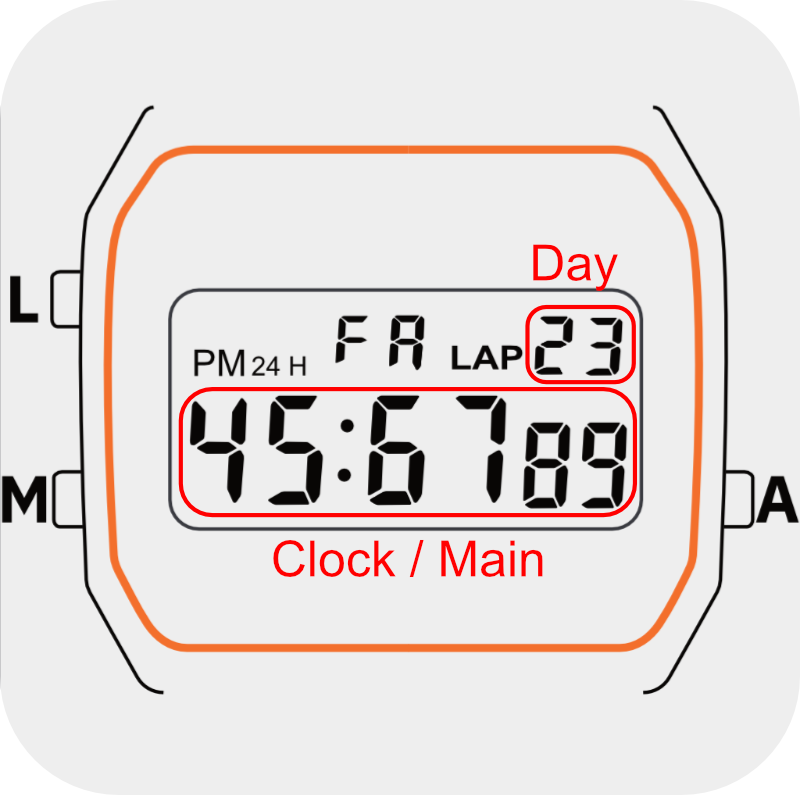

# Display

The Ollee Watch has a segment LCD, not a pixel screen. You turn on fixed
segments and icons, so a face is mostly digits and simple text.

## Layout



| Area | Positions | How you draw it |
| --- | --- | --- |
| Weekday digits | 0–1 | You can't. They show the face's slot name (`FA`, `FB` or `FC`) while your face is on screen. |
| Day digits | 2–3 | `Ollee.drawDay(text)`: 2 characters |
| Clock digits | 4–9 | `Ollee.drawMain(text)`: 6 characters |
| Colon | | `Ollee.drawColon(on)` |
| LAP, PM, 24H | | `Ollee.drawLap(on)`, `Ollee.drawPM(on)`, `Ollee.drawHR(on)` |
| Bell, chime | | You can't. They show the system alarm and hourly chime. |

## Drawing text

`drawMain` and `drawDay` take a string or a number. They keep the **first** 6
(or 2) characters and **right-align** what's left by padding with spaces on the
left:

```js
Ollee.drawMain(42);         // "    42"
Ollee.drawMain('hello');    // " hello"
Ollee.drawMain('1234  ');   // "1234  " (trailing spaces keep it left)
Ollee.drawMain('toolongtext'); // "toolon"
Ollee.drawDay(7);           // " 7"
```

To show a time, pad the parts yourself and turn on the colon:

```js
function pad(n) { return ('0' + n).slice(-2); }
Ollee.drawMain(pad(h) + pad(m) + pad(s));   // 12:34 56
Ollee.drawColon(1);
```

### Showing longer text

Only 6 characters fit, so scroll anything longer, such as a databank entry
from `Ollee.databank()` (up to 20 characters). Draw a 6-character window of the
text, and move it along one character per timer tick. Adding a space to the
end, and wrapping around, keeps the end and the start apart as they go by:

```js
function windowAt(text, off) {
  var loop = text + ' ';
  var w = '';
  for (var k = 0; k < 6; k++) w += loop.charAt((off + k) % loop.length);
  return w;
}
// every 350 ms: off = (off + 1) % (text.length + 1); Ollee.drawMain(windowAt(text, off));
```

A timer costs power for as long as it runs (see [Power](power.md)), so stop
it once the text has gone by, and let a button play it again.
[examples/databank.js](../../examples/databank.js) works this way.

Each draw call updates only its own area. `Ollee.clear()` blanks the digits and
the colon/LAP/PM/HR indicators, leaving the bell, chime and face name as they are.
Call it at the start of `enter()` so you don't inherit whatever was on screen
before.

Draw calls do nothing while your face isn't on screen (during `init()`, or
while another face is showing). See [Lifecycle](lifecycle.md).

## What characters look like

- Open the **Character set** panel in the emulator to see all of the characters that are encoded
- The first hour digit and first minute digit (positions 4 and 6) have a
  different segment layout and remap some characters, for example `L` and `7`.
- The first day digit (position 2) does not contain all seven segments, so many characters don't work on it. Stick to the numbers `1` through `3` for this position.
